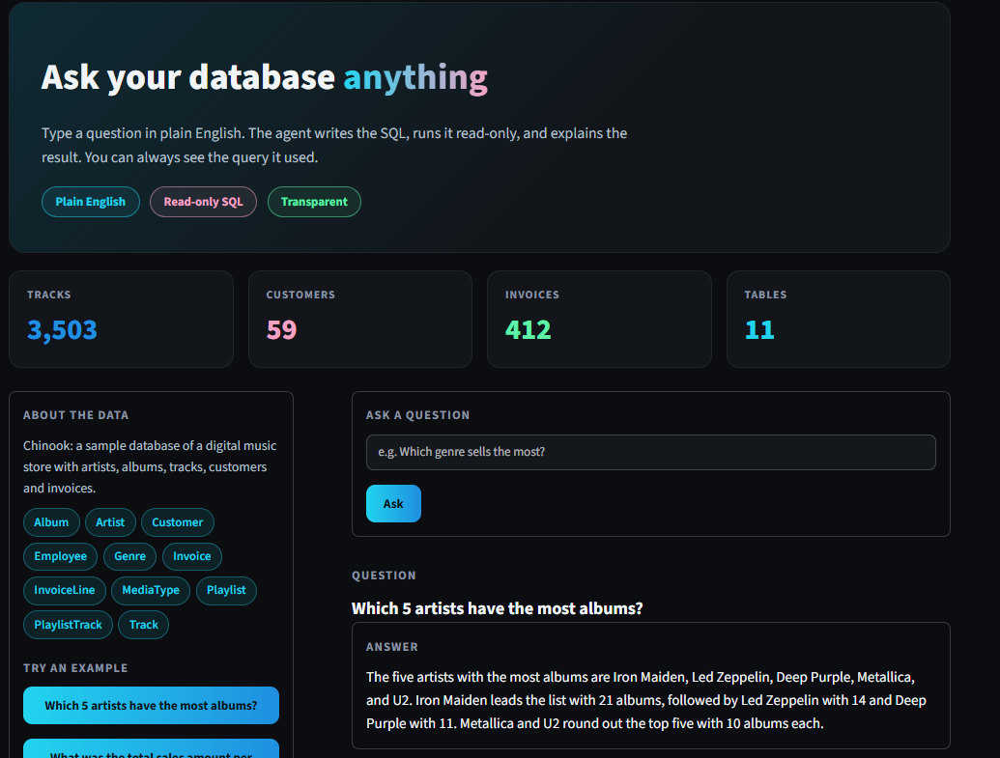
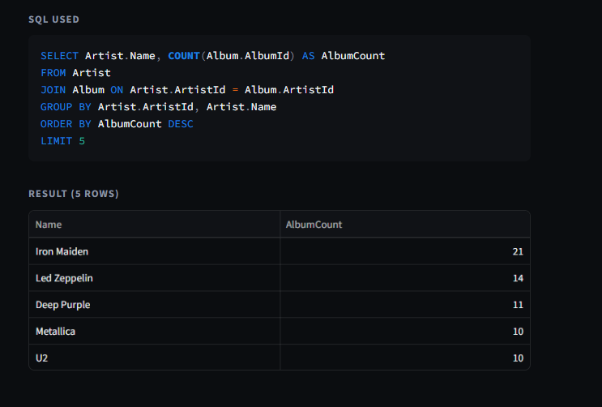

# SQL Agent: Ask Your Database in Plain English

Type a question in plain English. The agent writes the SQL, runs it **read-only**, and explains the result. The generated query is always shown, so every answer can be checked.

**Live demo:** https://chat-with-sql-asad.streamlit.app/




## Business value

Most business questions ("Which country brings the most sales?") are stuck waiting for someone who knows SQL. This agent lets non-technical staff query a database themselves, while the visible SQL keeps answers auditable.

## How it works

1. The database schema is placed in the prompt.
2. Gemini turns the question into one SQLite query.
3. A validator checks the query before it runs.
4. The query runs on a read-only connection with a timeout and a row cap.
5. If the query fails, the error is sent back to the model for one retry.
6. Gemini explains the result in plain English.
7. Every question is logged (question, SQL, rows, latency, error).

## Safety design

- Only a single `SELECT` or `WITH` statement is allowed.
- Forbidden keywords (`DROP`, `DELETE`, `UPDATE`, `INSERT`, `ALTER`, `PRAGMA`, `ATTACH`, ...) are blocked. Keywords inside string literals are handled correctly.
- The database is opened in read-only mode (`mode=ro`), so even a query that slipped past the validator cannot change data.
- 5-second query timeout and a 100-row result cap.
- Covered by automated tests: `python -m tests.test_safety`

## Results

Evaluated on 10 questions with known correct answers (`run_eval.py`, details in `reports/eval_results.csv`):

| Metric | Result |
|---|---|
| Correct answers | **10 / 10** |
| Typical latency | 2-6 s per question |

An answer counts as correct if the result values match a hand-written reference query.

## Limitations

- The test set is small (10 fairly simple questions). Complex, ambiguous or multi-step questions can still produce wrong SQL, so check the shown query.
- Built on Gemini's free tier: rate limits and occasional server overload. The app retries and falls back to other models, which can add a few seconds.
- Works on one database (Chinook, SQLite) with the schema in the prompt. Very large schemas would need schema retrieval.
- The plain-English explanation is written by an LLM; the SQL and table are the source of truth.
- The query log is stored locally and is not persistent on the free hosting.

## Run locally

```bash
git clone https://github.com/asadehsan11/sql-agent.git
cd sql-agent
python -m venv venv
venv\Scripts\activate        # Windows
pip install -r requirements.txt
```

Create a `.env` file with `GEMINI_API_KEY=your_key`, then:

```bash
streamlit run app.py
```

## Tech stack

Python, Streamlit, Google Gemini (`google-genai`), SQLite, pandas.

## Data

[Chinook sample database](https://github.com/lerocha/chinook-database): a digital music store with artists, albums, tracks, customers and invoices.

---
Built by [Asad Ehsan](https://github.com/asadehsan11)